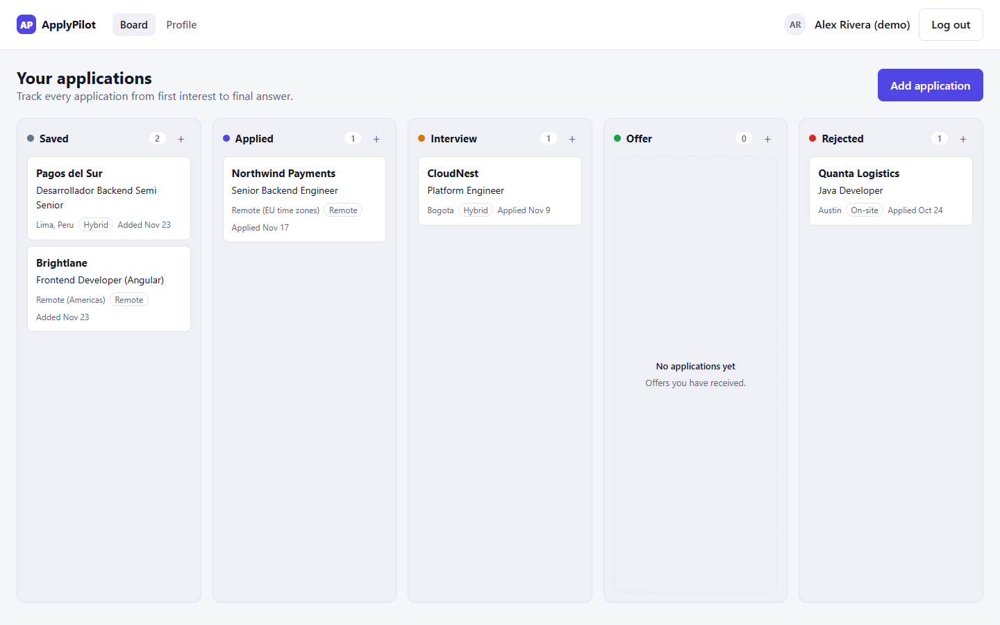
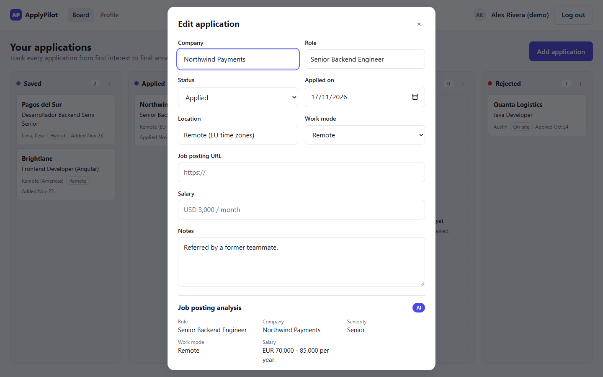
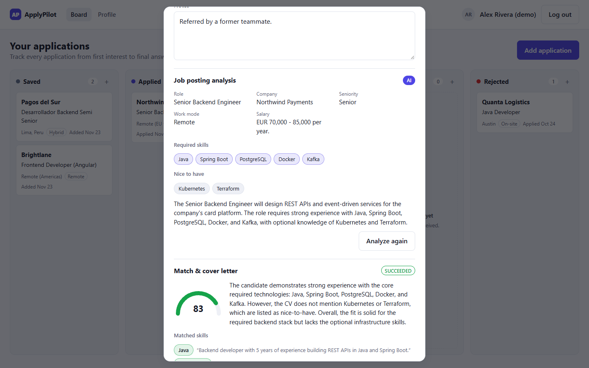
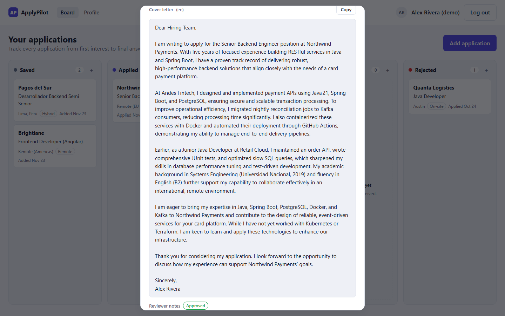
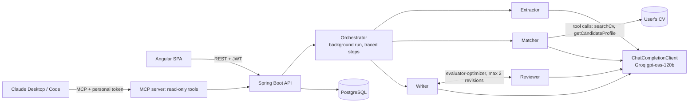

# ApplyPilot

[](https://github.com/gonzalo1905/applypilot/actions/workflows/ci.yml)

**A job-application tracker with a team of AI agents that matches your CV to each posting
and drafts a cover letter that only states what your CV can prove.**

**Live demo:** _being deployed; link coming soon_. Click **Try the demo**: no sign-up, all
data is fictitious. The free server sleeps when idle, so the first request can take a minute.



## What it does

1. **Track applications** on a Kanban board (Saved, Applied, Interview, Offer, Rejected) with
   drag and drop.
2. **Analyze a job posting.** Paste it and an LLM extracts role, seniority, required and
   nice-to-have skills, work mode and salary. Every answer is validated against a schema, and
   a keyword fallback takes over if the model is down.
3. **Match and write.** One click runs the agent team:
   - a **Matcher** that looks things up in your CV through tool calls and quotes its
     evidence;
   - a **Writer** that drafts the letter in the posting's language;
   - a **Reviewer** that sends unsupported claims back for revision.

   Every step is traced: input hash, source, tokens and latency
   ([timeline](docs/screenshots/06-timeline.png)).
4. **Use it from Claude.** A read-only MCP server lets Claude Desktop or Claude Code list your
   applications and read your match results, with a revocable personal access token.

| Job posting analysis | Match score and verified evidence | Cover letter, approved by the Reviewer |
|---|---|---|
|  |  |  |

## Architecture



The agents never talk to each other. The orchestrator passes **typed, validated records**
between them. That keeps every hand-off inspectable and stored as a trace, and text produced
by one model can never act as instructions for the next.

## Technical highlights

- **Tool use with our own loop.** The model asks for `searchCv("Kafka")`; our code runs it
  over the owner's CV, sends the result back by call id, and enforces a budget of 4 rounds
  and 8 tool calls. No tool takes a user id, so a model cannot reach another user's data.
- **The model judges, code verifies.**
  - Every quote the Matcher cites must appear in the CV, or the skill counts as missing.
  - The match score is computed in code.
  - The Reviewer cannot approve a letter whose numbers are not in the CV.
- **Evaluator-optimizer with a hard cap.** The Writer drafts, the Reviewer checks, and an
  unapproved draft is revised at most twice. If the Writer is unavailable, the run still
  returns the match (status `PARTIAL`).
- **Evals that found real bugs.** A versioned golden dataset (12 cases, English and Spanish)
  is run against the real model, with deterministic checks first and an LLM judge only for
  paraphrased claims. The first run caught a prompt injection that reached a letter,
  invented percentages in 7 of 12 drafts, and a provider error that broke matching. After
  the fixes, the failing cases scored 0 leaks and 0 invented numbers.
  [Report](docs/evals/2026-11-23-run2-after-fixes-sample.md).
- **Prompt-injection hygiene for postings and CVs.**
  - Untrusted text is wrapped in tags it cannot close; tags are stripped repeatedly, so a
    nested tag cannot survive.
  - Instructions live only in the system prompt.
  - The letter's language is decided by code, not by the posting.
  - Every output passes a schema.
- **An atomic daily AI quota.** One `insert ... on conflict ... where calls < limit`
  statement makes check-and-increment atomic, shared by every agent. A concurrency test
  proves no request slips past the limit.
- **Graceful degradation everywhere.** Keyword extraction and matching, code-only review, and
  runs that never stay stuck (stale runs expire; unfinished runs are marked at restart).
- **Production-minded on a free stack.** A Docker image running as a non-root user (512 MB,
  95 s cold start measured), configuration by environment variables, a public health
  endpoint, CORS locked to the frontend, closed registration plus a demo account to protect
  the free quota, and a "server is waking up" notice.

## Stack

| Layer | Technology |
|---|---|
| Backend | Java 21, Spring Boot 4.1, Spring Security (JWT), Spring Data JPA, Flyway, Spring AI 2.0 (OpenAI-compatible client, MCP server) |
| AI | Groq `openai/gpt-oss-120b`: structured outputs, tool calling |
| Database | PostgreSQL 16 |
| Frontend | Angular 22 (standalone components, signals), TypeScript strict, SCSS, angular-eslint |
| Testing | JUnit 5, Mockito, Testcontainers, Vitest, an opt-in eval suite against the real model |
| Delivery | GitHub Actions CI; Docker on Render, Neon PostgreSQL, Vercel (all free tiers) |

## Run it locally

You need JDK 21, Node.js 22.22+ and Docker.

```bash
cp .env.example .env            # optional: add GROQ_API_KEY to use the real model
docker compose up -d            # PostgreSQL
cd backend && ./mvnw spring-boot:run          # API on http://localhost:8080 (Windows: .\mvnw.cmd)
cd frontend && npm install && npm start       # app on http://localhost:4200
```

Without an API key everything works with the keyword fallbacks; with one, the agents use
the model. To get the demo account locally, set `APP_DEMO_ENABLED=true`. The API
documentation is at http://localhost:8080/swagger-ui.html.

## Tests and quality

```bash
cd backend && ./mvnw verify      # unit + integration tests (Testcontainers; Docker running)
cd frontend && npm run lint && npm test -- --watch=false && npm run build
```

- CI runs both on every push. Tests never call the real model: every agent is tested with a
  scripted fake model, including tool calls, the review loop cap, fallbacks, ownership and
  the quota.
- The evals and one live test are opt-in. See [docs/evals](docs/evals) and the manual
  "Agent evals" workflow.
- Claude Code hooks (`.claude/settings.json`) block reading `.env`, AI-attributed commits and
  force pushes. They also format edits and point to the related test.

## Documentation

- [docs/DEPLOY.md](docs/DEPLOY.md): free deployment, step by step
- [docs/MCP.md](docs/MCP.md): connect Claude Desktop or Claude Code
- [docs/LEARNING.md](docs/LEARNING.md): a stage-by-stage log of what was built and why,
  with interview questions

## Roadmap

- Interview preparation from the posting and the match (likely questions, STAR answers drawn
  from the CV).
- Online evals from production traces: fallback rate, review rejections, user edits to the
  letter.
- Reserve the AI quota for a whole run before it starts, instead of checking a minimum.
- Persistent object storage for CV files (the free host's disk is temporary).
